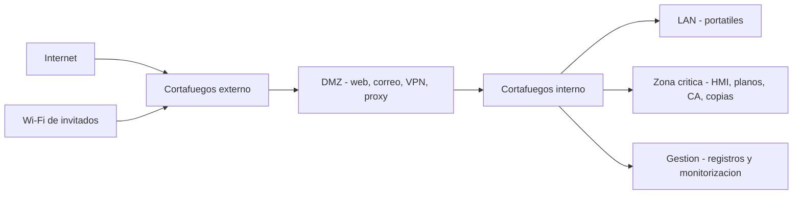

# Minirreto 1: coloca cada servicio en su zona

## Zonas disponibles

| Zona | Confianza | Idea |
|---|---|---|
| Internet | No confiable | Cualquiera, sin control |
| DMZ | Semiconfiable | Servicios expuestos a Internet, aislados de la LAN |
| LAN | Confiable | Usuarios y equipos propios |
| Zona crítica | Restringida | Activos de alto valor con pocos accesos |
| Invitados (propia) | No confiable | Wi-Fi de visitantes |
| Gestión (propia) | Restringida | Servidor de registros y monitorización |

Si un servicio no encaja en ninguna, créale una zona propia y defiende por qué.

- **Invitados.** Los móviles de clientes y proveedores no son equipos propios ni gestionados. En la LAN tendrían acceso a lo interno, y en la DMZ se mezclarían con servicios publicados. Solo necesitan salir a Internet, así que van en una zona aparte.
- **Gestión.** Los registros reciben datos de todas las zonas y son la prueba de lo que pasó. Si estuvieran en la LAN o en la DMZ, un atacante podría borrar sus huellas. Tampoco encajan en la zona crítica, que protege los activos de producción: aquí lo importante es que todos puedan enviar logs, pero casi nadie pueda entrar.

## Servicios de Torrent

1. Web corporativa pública
2. Servidor de correo
3. Pasarela VPN
4. Proxy (saliente e inverso)
5. HMI de planta y carpeta de planos
6. Autoridad de certificación (srv-ca)
7. Servidor de copias de seguridad
8. Portátiles de ingenieros y operarios
9. Wi-Fi de invitados
10. Servidor de registros y monitorización

---

## Qué tienes que entregar

### 1. Tabla de ubicación

Una fila por servicio:

| Servicio | Zona | Justificación (una frase) |
|---|---|---|
| Web corporativa | DMZ | Necesita ser accesible desde Internet; si la comprometen, la DMZ evita que el atacante llegue a la LAN. |
| Servidor de correo | DMZ | Tiene que recibir y enviar correo con Internet y maneja datos sensibles, así que va aislado de la LAN y con acceso mínimo hacia dentro. |
| Pasarela VPN | DMZ | Es el punto de entrada de los accesos remotos; en la DMZ se controla, con el cortafuegos interno, a qué recursos de la LAN puede llegar cada usuario autenticado. |
| Proxy saliente e inverso | DMZ | Es el intermediario entre Internet y la red: el inverso publica servicios y el saliente centraliza la navegación de la LAN. |
| HMI de planta | Zona crítica | Si cae se para la producción y los planos son valiosos, por lo que accede poca gente y no tiene salida a Internet. |
| Carpeta de planos | Zona crítica | Si se compromete, el atacante puede emitir certificados válidos y se rompe la confianza de toda la infraestructura, así que debe tener los accesos mínimos. |
| Autoridad de Certificación | Zona crítica | Quien la controle puede emitir certificados válidos y romper la confianza de toda la infraestructura, por eso no va en la DMZ. |
| Servidor de copias de seguridad | Zona crítica | Guarda una copia de todo y es la última defensa ante un ransomware, así que debe ser inalcanzable desde fuera y desde la LAN. |
| Portátiles | LAN | Son equipos propios que necesitan trabajar con recursos internos y salir a Internet, siempre a través del proxy. |
| Wi-Fi invitados | Zona propia | Son dispositivos ajenos que solo necesitan Internet, así que no ven nada de la empresa. |
| Servidor de registros y monitorización | Zona propia | Recibe logs de todas las zonas y debe protegerse para que el atacante no pueda borrar las pruebas. |

Para decidir, responde mentalmente a estas cuatro preguntas:

- ¿Necesita Internet?
- ¿Qué pasa si cae?
- ¿Qué datos maneja?
- ¿Quién necesita llegar a él?

### 2. Tabla de flujos

Qué conexiones se permiten y cuáles no entre zonas:

| Origen → destino | ¿Permitido? | Ejemplo concreto |
|---|---|---|
| Internet → DMZ | Sí | 80 y 443 TCP a la web; 25 TCP al servidor de correo; UDP 1194 a la pasarela VPN. Cualquier otro puerto, denegado. |
| Internet → LAN | No | Nada entra directo. Un socio desde casa llega por la VPN, no abriendo un puerto hacia la LAN. |
| DMZ → LAN | No | Pasarela VPN → srv-hmi, solo al puerto necesario. |
| LAN → DMZ | Sí | Un administrador gestiona la web por SSH (22/TCP); los usuarios leen el correo y navegan a través del proxy. |
| LAN → Internet | Sí | Navegación de los usuarios por el proxy saliente, que filtra y registra. Las salidas directas se bloquean. |

### 3. Un diagrama de la red

Puedes dibujarlo con el bloque de Mermaid de abajo (GitHub lo muestra solo) o subir una imagen.

### 4. Una pregunta de reflexión (3 o 4 líneas)

Si cae el servidor web, ¿qué puede hacer el atacante en tu diseño y qué se lo impide?

Con el servidor web comprometido, el atacante puede alterar la página, leer lo que haya en ese servidor y probar contra otros equipos de la DMZ. No puede llegar a la LAN, al HMI, a la CA ni a las copias, porque el cortafuegos interno impide que la DMZ inicie conexiones hacia dentro y la zona crítica solo es accesible desde la LAN autorizada.
